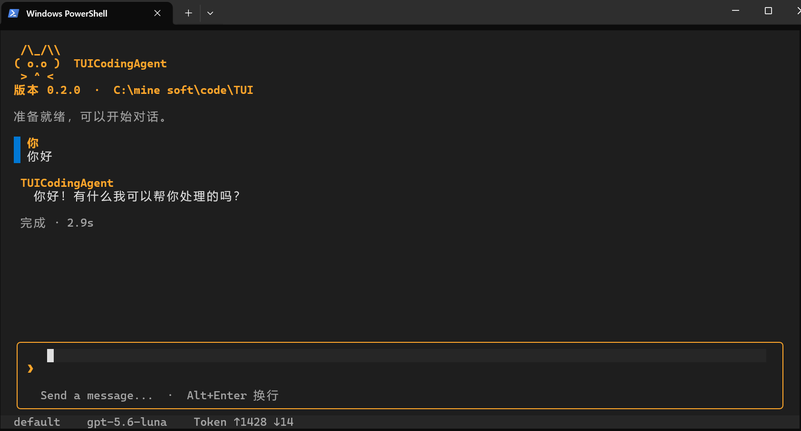

# TUICodingAgent

TUICodingAgent 是一个使用 Python 编写的终端 AI 编程助手。当前支持 OpenAI 与 Anthropic 两种流式协议、多轮上下文、扩展思考过滤、全屏 TUI，以及可由模型调用的本地工具系统。

系统提示由身份、约束、任务模式、动作、工具、语气和输出七个稳定模块确定性装配。工作目录、平台、日期、Git 状态、版本和模型作为独立动态环境块发送；Anthropic 使用显式缓存断点，OpenAI 保持稳定前缀，并统一统计端点返回的缓存创建/读取 Token。

## 实际使用效果



## 安装

需要 Python 3.11 或更高版本：

```powershell
python -m venv .venv
.venv\Scripts\python -m pip install -e ".[dev]"
```

有 uv 时可按仓库的锁文件恢复依赖：

~~~powershell
uv sync --locked --extra dev
uv run --locked python -m tuicodingagent
~~~

首次运行前，按下节配置模型凭据。

## 配置

复制 `config.example.yaml` 为项目当前目录下的 `config.yaml`，填写真实 API 密钥。每个 provider 支持以下字段：

- `name`：界面显示名称
- `protocol`：`openai` 或 `anthropic`
- `model`：模型名
- `base_url`：可选请求地址；Chat Completions/Anthropic 填完整端点，Responses 可填服务根地址或完整端点
- `api_key`：认证密钥
- `thinking`：可选布尔值，是否开启扩展思考
- `context_window`：可选正整数，覆盖协议默认上下文窗口
- `wire_api`：OpenAI 可选 `chat_completions`（默认）或 `responses`；Anthropic 仅支持 `messages`

使用 OpenAI Responses API 时，TUICodingAgent 以 `store: false` 请求，并在本地历史中保留端点返回的加密 reasoning item，以保证工具回灌和多轮推理连续；这些 opaque item 不会显示在 TUI 中。

配置只有一项时直接进入聊天；有多项时启动界面会要求用方向键选择。

## 运行

```powershell
python -m tuicodingagent
```

在输入框按 Enter 发送，Alt+Enter 插入换行。输入 `/exit` 或在空闲时按 Ctrl+C 安全退出。Agent 运行期间按 Esc 或 Ctrl+C 可取消当前任务，取消后仍能继续对话。

输入 `/` 会打开实时命令菜单，可继续输入前缀筛选，并用方向键、Tab、Enter 和 Esc 操作。内置命令包括 `/clear`、`/compact`、`/do`、`/exit`、`/help`、`/memory`、`/permission`、`/plan`、`/resume`、`/review`、`/session` 和 `/status`；帮助信息与补全菜单均来自同一个命令注册中心。

输入 `/plan` 可进入只读规划模式，此时模型只能使用读取与搜索工具；输入 `/do` 会恢复执行模式，并立即按已经形成的计划开始工作。状态栏会显示当前模式以及累计输入、输出 Token 用量。

输入 `/compact` 可手动压缩当前上下文。应用也会在接近上下文窗口时自动压缩，遇到 prompt-too-long 时执行一次紧急压缩并重试。摘要会与最近原文、最近读取的文件快照和工具定义共同组成恢复上下文；未知斜杠命令只在本地提示，不会发送给模型。

超过阈值的工具结果会按 UTF-8 字节落盘到 `.tuicodingagent/sessions/<session-id>/tool-results/`，对话中保留大小、预览、路径和重读提示。写入失败时保留原始结果，避免上下文丢失。会话目录退出后保留，并已加入 `.gitignore`。

## 项目指令、会话与记忆

启动时会依次加载项目根 `TUICODINGAGENT.md`、项目 `.tuicodingagent/TUICODINGAGENT.md` 和用户 `~/.tuicodingagent/TUICODINGAGENT.md`。可用独占行 `@include relative/path.md` 拆分规则；加载器限制五层嵌套，并防止环路、二进制内容和路径越界。项目级内容优先于用户级内容。

每次对话实时追加到 `.tuicodingagent/sessions/YYYYMMDD-HHMMSS-xxxx/conversation.jsonl`，每行都会 flush 和 fsync。输入 `/resume` 可搜索并选择历史会话；恢复会跳过坏行、截断未完成工具调用，在需要时先压缩，并对暂停超过六小时的会话添加时效提醒。新格式会话超过 30 天会在后台清理，旧格式目录不会被误删。

每五轮或用户明确说“记住”“别忘”“remember”等关键词时，应用会调用当前模型更新长期笔记。明确记忆会在本轮完成前落盘，并在模型未返回有效操作时安全兜底保存；每五轮的自动整理仍在后台执行。项目知识存放在 `.tuicodingagent/memory/`，通用用户偏好存放在 `~/.tuicodingagent/memory/`；`MEMORY.md` 索引会在后续请求前自动注入，单次注入最多 25KB。更新请求不携带工具，失败只记录日志，不阻塞或破坏主会话。

按 Shift+Tab 可在 `default`、`acceptEdits`、`plan` 和 `bypassPermissions` 四种权限模式间循环。写文件、编辑和命令等操作会按当前模式弹出审批框；可选择允许本次、始终允许或拒绝本次。危险命令黑名单与项目目录沙箱不可被 bypass 模式绕过。

权限规则可写在用户级 `~/.tuicodingagent/settings.yaml`、项目级 `.tuicodingagent/settings.yaml` 和本地级 `.tuicodingagent/settings.local.yaml` 中。规则支持精确值与 glob，冲突时按 `deny > ask > allow` 处理；`defaultMode` 按本地、项目、用户的优先级覆盖。示例：

```yaml
defaultMode: default
permissions:
  allow:
    - Read
    - "Write(src/**)"
  ask:
    - Bash
  deny:
    - "Read(.env*)"
```

“始终允许”会把当前调用的精确规则写入本地配置，该文件已默认加入 `.gitignore`。

## Skill 能力包

Skill 使用带 YAML frontmatter 的 Markdown 文件描述可复用 SOP，支持单文件和以 `SKILL.md` 为入口的目录型能力包。TUICodingAgent 按项目 `.tuicodingagent/skills/`、用户 `~/.tuicodingagent/skills/`、内置目录的顺序加载，同名定义由高优先级来源覆盖。启动时模型只看到名称与说明；需要时通过只读 `load_skill` 工具加载完整正文。

Skill 可选择 `inline` 模式共享主对话，或选择 `fork` 模式在独立上下文中执行后回流结果；`context` 可设为 `full`、`recent` 或 `none`。`tools` 白名单会收窄模型可见工具，多个激活 Skill 取交集，系统级 Skill 工具始终可用。正文中的 `$ARGUMENTS` 会替换为斜杠命令参数。

每个 Skill 自动注册为同名斜杠命令，并优先覆盖旧命令。使用 `/skill list`、`/skill info <name>` 和 `/skill reload` 管理目录；源文件在每次调用时热重读。内置样板包括 `/commit`、`/review` 和 `/test`，`/clear` 会同时清空已激活 Skill。

模型可通过 `install_skill` 从 skills.sh、GitHub tree 或 raw.githubusercontent.com 安装用户级 Skill。安装器限制文件大小、总大小、数量和深度，先在同级临时目录验证 `SKILL.md`，再原子落盘并热刷新命令。

## Hook 生命周期

Hook 通过项目 `.tuicodingagent/hooks.yaml` 与用户 `~/.tuicodingagent/hooks.yaml` 声明，两层规则按顺序叠加。支持 `SessionStart`、`SessionEnd`、`SessionResume`、`UserPromptSubmit`、`Stop`、`PreUserMessage`、`PreToolUse`、`PostToolUse`、`PreCompact`、`PostCompact` 和 `Notification` 共 11 个事件。

条件可组合 `all_of`、`any_of` 与嵌套字段，并复用 exact、glob、regex、not 匹配器。动作支持 shell、prompt、HTTP，以及本章保留日志占位的 subagent；还可配置 `only_once`、`async` 和 `timeout`。`PreToolUse` 能在权限判断与工具执行前阻断调用，`UserPromptSubmit` 能在写入历史和请求模型前阻断输入。使用 `/hooks` 查看按事件分组的有效规则、控制标志和来源文件。

配置错误或动作失败只输出到标准错误，不影响其余规则和主流程；但取消信号会正常向上传播。示例：

```yaml
hooks:
  - name: protect-env
    event: PreToolUse
    if:
      field: tool_name
      exact: write_file
    action:
      type: shell
      command: python scripts/check_write.py
    timeout: 5
```

## SubAgent 与后台任务

主 Agent 可通过稳定的 `Agent` 工具委派独立任务。指定 `subagent_type` 时从空白对话和角色系统提示启动；省略时复制父对话历史、补齐未完成工具调用并追加 `<fork_boilerplate>`，随后强制在后台运行。Fork 保留父消息前缀以利用 prompt cache，最终结果通过 `<task-notification>` 仅注入主 Agent 下一轮模型上下文，不显示为用户消息。

角色文件使用 YAML frontmatter + Markdown 正文，加载优先级为项目 `.tuicodingagent/agents/*.md`、用户 `~/.tuicodingagent/agents/*.md`、内置角色和插件占位。支持 `tools`、`disallowedTools`、`model`、`maxTurns`、`permissionMode` 与 `background`；内置 `general-purpose`、`explore`、`plan` 三种角色。非法用户角色会警告并跳过，非法 model 和 permissionMode 会回退安全默认值。

每个子 Agent 拥有独立消息、Token、权限模式和运行时状态，共享工具注册中心、Hook 与文件系统。定义式子 Agent 不可见 `Agent` 工具；Fork 虽保留工具定义以维持父级缓存前缀，但调用会被明确拒绝。后台任务还会叠加基础工具白名单，角色黑白名单继续收窄范围。

`TaskList`、`TaskGet`、`TaskStop` 和 `SendMessage` 可查询、取消或续派内存中的后台任务。任务也可通过 `run_in_background: true`、前台运行超过 120 秒或前台期间按 Esc 转入后台。配置 `enable_subagent_background: false` 可禁用这些切换，此时 Fork 不可用。

## Git Worktree 隔离

Agent 角色可在 frontmatter 中声明 `isolation: worktree`。TUICodingAgent 会在仓库内的 `.tuicodingagent/worktrees/agent-aXXXXXXX/` 创建独立 Git Worktree 和 `worktree-agent-aXXXXXXX` 分支，把父目录与副本路径提示注入子 Agent，并通过显式 cwd 让 `read_file`、`write_file`、`edit_file`、`bash`、`glob`、`grep` 全部在副本执行，进程不会依赖 `chdir` 切换。

无变更的临时 Worktree 会自动删除；有未提交修改或新增 commit 时会保留，并把路径和分支附加到子 Agent 结果供主 Agent 审查。创建时会尽力复制本地配置、配置 Git hooks、链接大型依赖目录，并按 `.worktreeinclude` 复制被忽略但运行必需的文件。任何状态检查失败都按“有变更”处理，避免误删。

用户也可执行 `/worktree create <slug>`、`/worktree list`、`/worktree enter <slug>`、`/worktree exit [--remove] [--discard]` 和 `/worktree remove <slug> [--discard]` 手动管理。名称允许安全的嵌套斜杠，但禁止路径遍历；手动创建的 Worktree 不参与自动清理。Worktree 之间的合并仍由用户使用 `git merge` 或 `git cherry-pick` 决定。

## MCP 扩展工具

TUICodingAgent 可在启动时通过官方 MCP SDK 连接 stdio 与 Streamable HTTP Server。用户级配置位于 `~/.tuicodingagent/config.yaml`，项目级配置位于 `.tuicodingagent.yaml`；两层按 Server 名合并，项目级同名定义完整覆盖用户级。完整示例见 `mcp.example.yaml`：

```yaml
mcp_servers:
  local-tools:
    type: stdio
    command: python
    args: [path/to/server.py]
    env:
      SERVICE_TOKEN: "${SERVICE_TOKEN}"
  remote-tools:
    type: http
    url: https://example.com/mcp
    headers:
      Authorization: "Bearer ${MCP_API_TOKEN}"
```

只有 `env` 和 `headers` 的值会展开 `${VAR}`。成功发现的工具以 `mcp__<server>__<tool>` 出现在工具中心；自报 `readOnlyHint` 的工具按只读权限处理，其余默认需要审批。可在权限配置中使用 `mcp__github__*` 形式的 allow / ask / deny 规则。单个 Server 启动失败不会阻止应用或其他 Server，连接与调用各自有 30 秒超时，退出时会统一关闭会话和 stdio 子进程。

执行模式和规划模式约束通过不持久化的 `<system-reminder>` 注入请求副本。Plan Mode 第 1 轮以及之后每隔 4 轮发送完整提醒，其余轮次发送精简提醒，不会污染会话历史或稳定缓存前缀。

## 工具

模型可调用以下六个工具：

- `read_file`：读取带行号的 UTF-8 文件内容
- `write_file`：创建或覆盖文件，并自动创建父目录
- `edit_file`：仅在原文本唯一匹配时替换
- `bash`：执行命令并返回退出码、标准输出和标准错误
- `glob`：按模式查找文件
- `grep`：按正则表达式搜索文件内容

工具执行状态和结果摘要会显示在对话中。TUICodingAgent 会通过 ReAct Agent Loop 持续把工具结果交还模型，直到任务自然完成；连续只读调用会并发执行，写入、编辑和命令等副作用操作保持串行。单次任务最多迭代 12 轮，连续请求未知工具也会被自动熔断。

## 测试

```powershell
python -m pytest
python -m ruff check src tests
python -m compileall -q src tests
```

各章逐项验收记录位于 `docs/chNN/checklist.md`。

## Agent Teams

主 Agent 可调用 `TeamCreate` 创建长期团队，再通过
`Agent(team_name="团队", name="队员", ...)` 在独立 Git Worktree 派出队员。
队员使用共享任务和持久化邮箱协作；完成后 Lead 会收到 idle 通知，之后可用
`SendMessage(to="队员", content="新任务")` 恢复原对话继续工作。

本地命令 `/team list`、`/team info <name>`、`/team delete <name> [--force]`
和 `/team kill <member>` 用于检查与管理团队。运行后端按 tmux、iTerm2、tmux
可执行文件、in-process 的顺序探测。

Coordinator Mode 需要配置和环境变量同时开启：

```yaml
features:
  coordinator_mode: true
```

```powershell
$env:TUICODINGAGENT_COORDINATOR_MODE = "1"
python -m tuicodingagent
```

启用后 Lead 仅保留编排、只读检查及 `bash` 收敛工具，状态栏显示
`[COORDINATOR]`。

## 最新验证结果

工具按需加载在固定资源标识的真实模型任务中完成 10/50/100/200 工具对照：200 工具档的平均模型输入由 9,855 降至 300 tokens，全部 24 次完成样本均选对工具及参数。同一合成会话跨两次进程恢复后累计活跃运行 8 小时、956 轮；该结果验证长任务状态与恢复，不代表真实模型连续编码能力。长会话工具输出以受管工件落盘，避免将完整内容反复注入上下文。

这些结果的样本、环境和解释边界见 [已验证实验摘要](docs/evaluation/verified_summary.md)。
